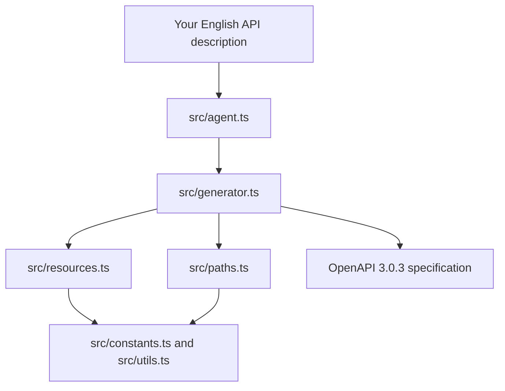

# API Spec Agent

API Spec Agent turns a plain-English API description into an OpenAPI 3.0.3 specification.

For example, this input:

```text
Build an e-commerce API with products, orders, and users
```

produces an OpenAPI document with resource schemas and CRUD-style endpoints.

## How It Works

1. `src/agent.ts` is the public entry module. It exports the generator functions.
2. `src/generator.ts` coordinates the complete generation process.
3. `src/resources.ts` finds resources in the English description and creates their schemas.
4. `src/paths.ts` creates collection and item API paths for each resource.
5. `src/constants.ts` provides shared values such as the default server URL and common fields.
6. `src/utils.ts` contains name-conversion helpers.
7. `src/types.ts` defines the TypeScript types used by the project.
8. The generated `OpenApiSpec` object is returned, or converted to formatted JSON.



## Main Functions

Import the functions from `src/agent.ts`:

```typescript
import {
  generateOpenApiSpec,
  generateOpenApiJson,
  parseEnglishToOpenApi,
} from "./src/agent";

const description = "Build an e-commerce API with products, orders, and users";

const specification = generateOpenApiSpec(description);
const json = generateOpenApiJson(description);
const parsed = parseEnglishToOpenApi(description);

console.log(specification);
console.log(json);
console.log(parsed);
```

`parseEnglishToOpenApi` currently behaves the same as `generateOpenApiSpec`.

## Project Structure

```text
api-spec-agent/
├── package.json          Project scripts and dependencies
├── tsconfig.json         TypeScript compiler configuration
├── README.md             Project documentation
└── src/
    ├── agent.ts          Public API and exports
    ├── generator.ts      Main OpenAPI generation workflow
    ├── resources.ts      Resource detection and schema creation
    ├── paths.ts          Endpoint and operation creation
    ├── constants.ts      Shared constants and common schema fields
    ├── types.ts          TypeScript type definitions
    ├── utils.ts           Name-formatting helpers
    ├── formatter.ts      Reserved for formatting logic
    ├── prompt.ts         Reserved for prompt logic
    └── index.js           Currently empty
```

## Development

Install dependencies:

```bash
npm install
```

Check the TypeScript code:

```bash
npx tsc --noEmit
```

Build the TypeScript files:

```bash
npm run build
```

Generate a specification from the terminal:

```bash
npm start -- generate -d "Build an e-commerce API with products, orders, and users" -o api-spec.json
```

The command writes a formatted OpenAPI JSON file to `api-spec.json`. The output path is optional and defaults to that filename.

`npm start` builds the TypeScript modules first, then runs the CLI in `src/index.js`. `npm run dev` does the same for local development.

## Current Behavior and Limitations

- Resource detection uses simple text matching and regular expressions.
- Supported common resources include products, orders, users, customers, invoices, items, categories, addresses, transactions, payments, cart, reviews, posts, and comments.
- If no resource is detected, the default resources are `products`, `orders`, and `users`.
- The generated server URL is always `https://api.example.com`.
- The output is a generated starting point and may need customization for authentication, validation, pagination, error formats, and business-specific fields.
